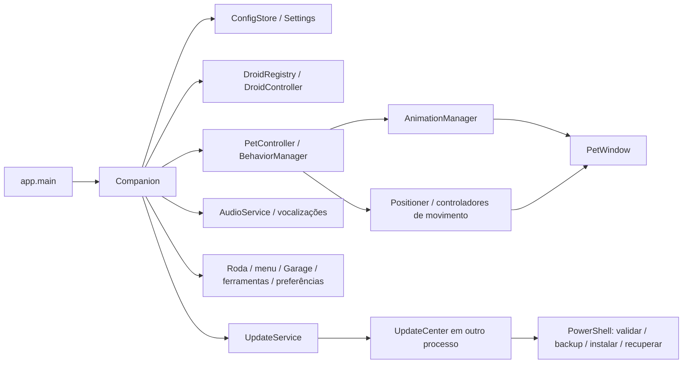

# Arquitetura do R2 Desktop Companion

Versão 1.1.1. Aplicativo local Python/PySide6 para Windows 10/11, com uma
QApplication por processo, sem backend, modelos de IA ou telemetria.

## Composição

`app.Companion` compõe os serviços existentes e conecta suas intenções por sinais.
O processo normal possui um PetController, um Positioner, um AnimationManager e um
AudioService. A Central de Atualizações executa em processo independente.

## Personagens, movimento e áudio

DroidRegistry valida e registra perfis de Original, Vesper e Orbita em
`assets/droids/`. DroidProfile descreve tema, catálogo, renderer, áudio,
personalidade e personalizações. Os atlas PNG anteriores continuam preservados;
DroidVisual permite corpo e cabeça independentes na renderização em camadas.

DroidController prepara recursos antes de uma troca. Companion preserva a posição
e transfere os recursos ao controlador existente; falhas restauram o estado
anterior. Positioner continua responsável por limites, monitores e posição em DIP.
Os controladores de movimento adaptam locomoção comum ou esférica sem duplicar a
máquina de estados. Tokens invalidam callbacks de ações interrompidas.

AudioService mantém QSoundEffect, bancos por perfil, frases geradas com sílabas
originais, volume, categorias, cooldowns e contexto. ReactionDirector coordena
cenas com PetController. Prévias respeitam a política de áudio e liberam seu banco
ao fechar. A troca de personagem não liga o áudio global automaticamente.

## Navegação e interfaces

`ui/navigation.py` registra identificadores, rótulos, ícones e níveis da roda.
Companion.navigation_actions fornece os mesmos callbacks para roda e menu de
contexto. Cada QAction tem identificador em data e referências fortes mantidas
pelo menu. O argumento checked não substitui os destinos capturados.

A roda possui seis entradas: Garage, Ferramentas, Minigames, Autodiagnóstico,
Projetar e Configurações. Ferramentas abre central ou página específica;
Configurações inclui preferências, áudio, atualização, favoritos e autonomia.
O centro retorna pelo histórico; na raiz, fecha. Escape, ×, clique externo e
inatividade fecham e restauram a raiz. A desativação da janela é confirmada após
80 ms para tolerar eventos transitórios de foco do Windows.

QParallelAnimationGroup coordena geometria e opacidade: saída de 80 ms e entrada
de 160 ms. A transição desabilita seleções duplicadas. Fechar interrompe e libera
os grupos; nenhum loop de animação bloqueia a GUI. O gate radial suspende autonomia
durante toda a navegação e é liberado no fechamento.

DroidGarage é a única janela de personagens e animações. Reutiliza DroidStudio,
PreviewCanvas e AnimationManager para categorias, sequências, repetição, frames e
movimento. Seu tema local segue o perfil de prévia; somente Equipar altera o
personagem ativo e salva preferências. Não há AnimationGallery independente.

ToolsDialog reutiliza as páginas implementadas de relógio, temporizador, sistema,
tarefas, notas, minigames e diagnóstico. Um mapa de páginas evita índices espalhados
pelos callbacks. Abertura restaura uma janela minimizada. Diagnóstico atualiza os
dados ao abrir e permite executar novamente sua cena de inspeção. O catálogo de
minigames abre URLs validadas no navegador padrão por QDesktopServices.

## Projeções e temas

Ferramentas não ativa hologramas. Projetar seleciona relógio ou horário/data no
PetWindow, usando local_clock e as cores do personagem equipado. O timer de 1 s
atualiza conteúdo; o timer transitório de 1800 ms não se aplica às projeções
explícitas. Encerrar limpa ambos; ocultar suspende atualização, mostrar retoma.
A mudança de tema redesenha o conteúdo. Projeções não alteram os dados salvos.

DroidTheme fornece tokens e parâmetros visuais. ThemeManager atualiza estilos,
ícones, paletas e widgets. Overrides de prévia não alteram o tema global.
PersistedThemeWatcher observa o diretório de configuração para acompanhar o personagem
ativo em processos independentes, sem polling. Não mantém um handle no arquivo
config.json, permitindo substituições atômicas sucessivas no Windows.

## Atualização e continuidade visual

UpdateService inicia UpdateCenter com instalação, dados e identidade do processo
proprietário. UpdateWorker usa QThread para consulta, download e cópia. Sinais
carregam bytes, estágios, resultados e erros até a GUI. O progresso determinado
usa bytes reais; sem total, o indicador é indeterminado. Operações desabilitam
o botão imediatamente e impedem fechamento por X, Escape ou botão Fechar.

Após SHA-256, a central prepara uma cópia do bundle fora da instalação. A original
permanece visível enquanto a cópia inicia. A sucessora grava um arquivo exclusivo
center-ready com PID e confirmação de uma janela exposta e pintada; a original confirma com um
arquivo ack antes de fechar. A sucessora aguarda esse ack antes de executar o
instalador. A central permanece acima das janelas comuns para manter o progresso
visível durante a transferência. Timeout ou falha mantêm uma mensagem na janela existente e preservam
a instalação. Essa troca usa os diretórios de operação já existentes.

O instalador PowerShell preserva validações de origem, versão, tamanho, SHA-256,
ZIP, caminhos e links. Reconsulta a release, extrai para staging, encerra a instância
identificada, cria backup e substitui a instalação com recuperação em caso de erro.
status.json informa validação, instalação, reinício, conclusão, necessidade de
reinício ou falha. A central acompanha o processo e confere a versão instalada
antes de anunciar sucesso. O usuário pode consultar os logs e tentar novamente.

## Persistência e ciclo de vida

Settings permanece no schema 1, com defaults aditivos e preferências independentes
em droid_preferences. ConfigStore mantém QLockFile, QSaveFile, debounce, backup,
recuperação de corrupção e proteção de schema futuro. Campos antigos desconhecidos
são ignorados pela leitura sem remover catálogos de recursos. ProductivityStore
reutiliza escrita atômica em tools.json, com backup e limites próprios.

Contagem regressiva usa deadline e run ID; continua oculta ou em sono. Gates de
arraste, menu, roda, configurações, ocultação e sessão suspendem autonomia.
Tela cheia respeita o modo salvo e o canto manual. ContextReactions solicita ações
ao controlador e não captura tela nem registra teclas. Shutdown idempotente para
movimentos, animações, efeitos, áudio, timers e notificações e libera o lock.

## Build, testes e documentação

`tools/build_windows.py` usa a versão de pyproject.toml, PyInstaller one-folder,
manifesto asInvoker e assets existentes. Empacota script de atualização, metadata,
plugins Qt Multimedia e licenças. Gera ZIP e SHA-256; pastas por versão preservam
builds anteriores. Testes incluem Qt, integração Windows, persistência e segurança
do instalador. `tools/verify_navigation.py` captura os três temas e a navegação;
`tools/verify_update_center.py` testa a instalação real com transporte local.

README e este documento são as referências principais da raiz. Changelog, notas
de versão e avisos de terceiros públicos ficam em packaging/docs. Auditorias,
relatórios, cópias pessoais e evidências ficam em local_docs, ignorado
pelo Git; não são incluídos no pacote.
