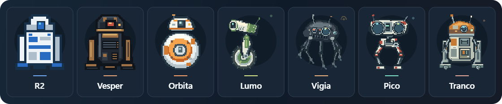
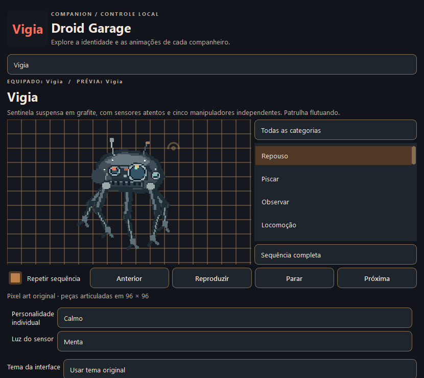
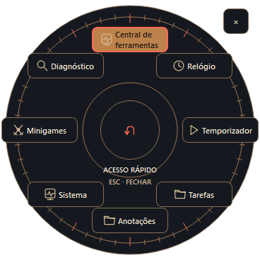

# R2 Desktop Companion

[English](README.md)

Um companheiro de desktop para Windows com sete droides animados, ferramentas de acesso rápido e tarefas e notas locais. Escolha um droide na Droid Garage e use a roda de ações para iniciar uma sessão de foco, controlar a música ou projetar um relógio no desktop.



[Baixar para Windows](https://github.com/nicolasgrotto/r2-desktop-companion/releases/latest) · [Histórico de versões](packaging/docs/CHANGELOG-pt-br.md) · [Executar pelo código](#executar-pelo-código)

## Primeiros passos

1. Baixe **R2Companion-Windows-x64.zip** em [GitHub Releases](https://github.com/nicolasgrotto/r2-desktop-companion/releases).
2. Extraia o ZIP completo em uma pasta com permissão de escrita, como `%LOCALAPPDATA%\Programs\R2Companion`.
3. Abra **R2Companion.exe** na pasta extraída. O pacote portátil inclui o runtime.

O Companion é destinado ao **Windows 10/11 x64**. As ferramentas de desktop funcionam offline. Atualizações e minigames web precisam de internet.

## Usar o Companion

| Para fazer isto | Por onde começar |
| --- | --- |
| Abrir a roda de ações | Clique com o botão esquerdo no droide. Pressione **Esc** para fechar. |
| Mover o droide ou abrir seu menu | Arraste para mover. Clique com o botão direito no mascote ou use a bandeja para abrir o menu. |
| Trocar de droide, ver animações ou ajustar o tema | Abra a **Droid Garage**. Use a **Central de Áudio** para ouvir vozes e efeitos e ajustar o volume por droide. |
| Iniciar uma sessão de foco | Abra **Foco** pela roda. Escolha uma duração, vincule uma tarefa se quiser e projete a contagem. Uma sessão em andamento volta pausada ao reiniciar. |
| Controlar a música | Em **Ferramentas → Música**, ative o controle musical do Windows e escolha o modo automático ou um player específico. Os controles dependem do que o player disponibiliza. |
| Gerenciar tarefas, notas e jogos | Abra **Ferramentas** para acessar relógio, temporizador, sistema, tarefas, notas, diagnóstico e minigames. Minigames pessoais abrem links HTTPS no navegador padrão. |
| Buscar uma ação pelo teclado | Pressione **Win+B**, selecione o Companion na bandeja e use **Shift+F10**. Abra **Buscar ações** ou habilite o atalho configurável **Ctrl+Alt+R** em Preferências. |
| Mudar idioma, escala ou movimento | Abra **Configurações → Preferências**. Escolha Português (Brasil) ou English e selecione **Reiniciar Companion** para aplicar o idioma. A mesma página oferece movimento reduzido e escalas de 100%, 125% e 150%. |

<kbd>Tab</kbd> e <kbd>Shift</kbd>+<kbd>Tab</kbd> percorrem os painéis. <kbd>Enter</kbd> ou <kbd>Espaço</kbd> ativa o controle em foco.

Use **Projetar** para mostrar o relógio ou a data, ou abra **Temporizador** para projetar uma contagem. As preferências também incluem horário de silêncio, comportamento em tela cheia e movimento. Use **Aplicativos** ou **Meus locais** para abrir aplicativos, pastas e arquivos salvos.




### Escolher um modo de presença

- **Livre** segue as suas preferências de movimento e som.
- **Foco** pausa passeios e sons espontâneos e mantém o mascote visível.
- **Apresentação** oculta o mascote e as projeções e silencia avisos. Use **Mostrar mascote** na bandeja para voltar.

## Dados e atualizações

Preferências, tarefas e notas ficam por padrão em `%LOCALAPPDATA%\R2DesktopCompanion\R2Companion`. Em **Ferramentas → Dados**, exporte tarefas e notas para JSON ou restaure as duas coleções ou somente uma pelo backup local. A aba Notas exporta a anotação selecionada como texto UTF-8.

Para atualizar, abra **Verificar atualizações** na bandeja. O atualizador precisa de internet, Windows PowerShell 5.1 e permissão de escrita na pasta de instalação. Ele verifica o download, guarda um backup da instalação e reinicia o Companion no mesmo perfil. Você também pode sair da versão antiga e extrair a nova em outra pasta. Mantenha `release.json` e `_internal` junto ao executável.

Para iniciar com o Windows, copie a pasta portátil completa para um local estável e habilite **Iniciar com o Windows** nas Configurações. Em caso de falha de inicialização ou atualização, consulte `companion.log` ou `updates\update.log` no diretório de dados.

## Executar pelo código

Use Python 3.12 ou mais recente no Windows x64. No PowerShell, a partir da raiz do repositório:

```powershell
py -m venv .venv
.\.venv\Scripts\python.exe -m pip install -r requirements.txt
.\.venv\Scripts\python.exe run_companion.py --data-dir .runtime-manual
```

Para testar e empacotar:

```powershell
.\.venv\Scripts\python.exe -m pip install -r requirements-dev.txt
$env:QT_QPA_PLATFORM = 'offscreen'
.\.venv\Scripts\python.exe -m pytest -q -m 'logic or qt'
Remove-Item Env:QT_QPA_PLATFORM
.\.venv\Scripts\python.exe tools\build_windows.py --artifact-label local-review
```

O build gera uma pasta portátil em `dist\`, o ZIP e o arquivo com o SHA-256. Consulte o [guia de testes](tests/README.md) para rodar testes no desktop Windows e a [arquitetura](ARCHITECTURE-pt-br.md) para entender os componentes e os dados. Contribuições são bem-vindas via [issues](https://github.com/nicolasgrotto/r2-desktop-companion/issues) e [pull requests](https://github.com/nicolasgrotto/r2-desktop-companion/pulls).

## Projeto e licença

O Companion nasceu do [R2-D2 Casemod](https://github.com/nicolasgrotto/R2-D2-Casemod) da UniFECAF e roda independentemente do hardware. O catálogo de Minigames inclui [Duel of Fates](https://github.com/nicolasgrotto/duel-of-fates).

[Licença MIT](LICENSE) · [Créditos dos recursos](src/r2_companion/assets/LICENSES.md) · [Avisos de terceiros](packaging/docs/THIRD_PARTY_NOTICES.md)
