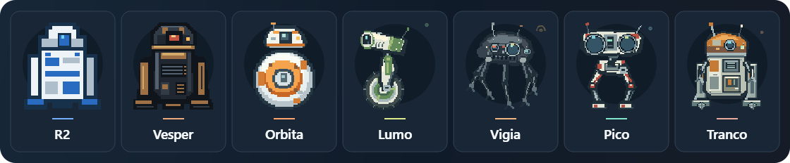
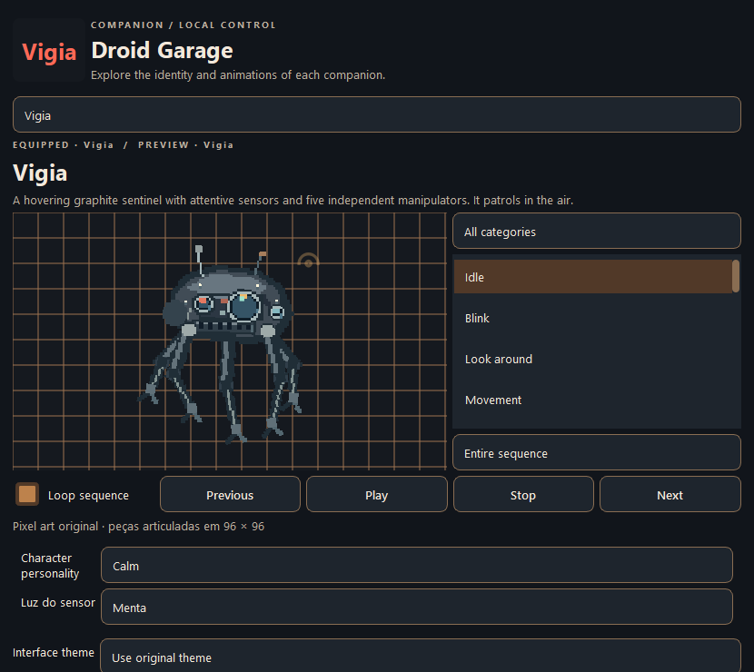
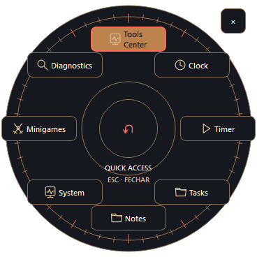

# R2 Desktop Companion

[Português (Brasil)](README-pt-br.md)

A Windows desktop companion with seven animated droids, quick-access tools, and local tasks and notes. Pick a droid in the Droid Garage, then use its action wheel to start a focus session, control music, or project a clock onto your desktop.



[Download for Windows](https://github.com/nicolasgrotto/r2-desktop-companion/releases/latest) · [Changelog](packaging/docs/CHANGELOG.md) · [Build from source](#build-from-source)

## Get started

1. Download **R2Companion-Windows-x64.zip** from [GitHub Releases](https://github.com/nicolasgrotto/r2-desktop-companion/releases).
2. Extract the entire ZIP to a folder you can write to, such as `%LOCALAPPDATA%\Programs\R2Companion`.
3. Run **R2Companion.exe** from the extracted folder. The portable build includes its runtime.

The companion targets **Windows 10/11 x64**. Desktop tools work offline. Updates and web minigames need an internet connection.

## Use the companion

| Do this | Where to start |
| --- | --- |
| Open the action wheel | Left-click the droid. Press **Esc** to close it. |
| Move the droid or open its menu | Drag to move it. Right-click it or use the system tray for the menu. |
| Switch droids, preview animations, or set a theme | Open **Droid Garage**. Use **Audio Center** for voices, effects, and per-droid volume. |
| Start a focus session | Open **Focus** from the wheel. Pick a duration, optionally link a task, and project the countdown. A running session resumes paused after restart. |
| Control music | In **Tools → Music**, enable Windows media control and choose automatic selection or a specific player. Controls depend on what that player exposes. |
| Manage tasks, notes, and games | Open **Tools** for the clock, timer, system information, tasks, notes, diagnostics, and minigames. Personal minigames open HTTPS links in your default browser. |
| Find an action by keyboard | Press **Win+B** to reach the tray, select the Companion, and press **Shift+F10**. Open **Search actions** or enable its configurable **Ctrl+Alt+R** shortcut in Preferences. |
| Change language, scale, or motion | Open **Settings → Preferences**. Choose English or Brazilian Portuguese and select **Restart Companion** to apply the language. The same page offers reduced motion and 100%, 125%, or 150% interface scaling. |

<kbd>Tab</kbd> and <kbd>Shift</kbd>+<kbd>Tab</kbd> move through panels. <kbd>Enter</kbd> or <kbd>Space</kbd> activates the focused control.

Use **Project** to display the clock or date, or open **Timer** to project a countdown. Preferences also cover quiet hours, fullscreen behavior, and the companion's movement. Use **Applications** or **My places** for saved apps, folders, and files.




### Pick a presence mode

- **Free** follows your movement and sound preferences.
- **Focus** pauses roaming and spontaneous sounds while keeping the companion visible.
- **Presentation** hides the companion and projections and silences notifications. Select **Show mascot** in the tray to return.

## Data and updates

Preference, task, and note files live in `%LOCALAPPDATA%\R2DesktopCompanion\R2Companion` by default. Use **Tools → Data** to export tasks and notes as JSON or restore either collection or both from a local backup. The Notes page can export a selected note as UTF-8 text.

For updates, open **Check for updates** from the tray menu. The updater needs internet access, Windows PowerShell 5.1, and a writable installation folder. It verifies the download, backs up the installation, and restarts the companion using the same data profile. You can also quit the old version and extract a new release to a separate folder. Keep `release.json` and `_internal` alongside the executable.

To launch with Windows, copy the complete portable folder to a stable location and enable **Start with Windows** in Settings. If there is a startup or update problem, look for `companion.log` or `updates\update.log` in the data directory.

## Build from source

Use Python 3.12 or newer on Windows x64. From the repository root in PowerShell:

```powershell
py -m venv .venv
.\.venv\Scripts\python.exe -m pip install -r requirements.txt
.\.venv\Scripts\python.exe run_companion.py --data-dir .runtime-manual
```

For tests and packaging:

```powershell
.\.venv\Scripts\python.exe -m pip install -r requirements-dev.txt
$env:QT_QPA_PLATFORM = 'offscreen'
.\.venv\Scripts\python.exe -m pytest -q -m 'logic or qt'
Remove-Item Env:QT_QPA_PLATFORM
.\.venv\Scripts\python.exe tools\build_windows.py --artifact-label local-review
```

The build writes a portable folder under `dist\` and a ZIP with its SHA-256 file. See the [test guide](tests/README.md) for Windows desktop tests and the [architecture](ARCHITECTURE.md) for the runtime and data model. Contributions are welcome through [issues](https://github.com/nicolasgrotto/r2-desktop-companion/issues) and [pull requests](https://github.com/nicolasgrotto/r2-desktop-companion/pulls).

## Project and license

The companion grew out of the [R2-D2 Casemod](https://github.com/nicolasgrotto/R2-D2-Casemod) at UniFECAF and runs independently of the hardware. The Minigames catalog includes [Duel of Fates](https://github.com/nicolasgrotto/duel-of-fates).

[MIT license](LICENSE) · [Asset credits](src/r2_companion/assets/LICENSES.md) · [Third-party notices](packaging/docs/THIRD_PARTY_NOTICES.md)
